<picture>
  <source media="(prefers-color-scheme: dark)" srcset="assets/banner-dark.svg">
  <source media="(prefers-color-scheme: light)" srcset="assets/banner-light.svg">
  
</picture>

<i>Probably debugging something right now · PhD life, fueled by coffee and curiosity</i>

### 🧑‍💻 About

- 🏫 **Now:** PhD student at **Sun Yat-sen University**, School of Intelligent Systems Engineering
- 🔬 **Research:** autonomous driving and large language models, currently focused on **VLA for autonomous driving**
- 🌱 **Exploring:** agents and world models
- 🛠️ **Building:** the [Rayburst](https://github.com/AnInsomniacy/rayburst) download stack, mostly at hours I should be asleep
- 🏸 **Off hours:** badminton with professional training, sanda and boxing with some
- 📫 **Reach me:** [qq1326555262@gmail.com](mailto:qq1326555262@gmail.com)

### 🚀 Open source

<a href="https://github.com/AnInsomniacy/rayburst">
  <picture>
    <source media="(prefers-color-scheme: dark)" srcset="assets/rayburst-dark.svg">
    <source media="(prefers-color-scheme: light)" srcset="assets/rayburst-light.svg">
    
  </picture>
</a>

  
  
  
  

**The Rayburst stack**

- [**Rayburst**](https://github.com/AnInsomniacy/rayburst): download manager for macOS, Windows and Linux. HTTP, BitTorrent, ED2K, HLS/DASH. [rayburst.pages.dev](https://rayburst.pages.dev)
- [**Rayburst Connect**](https://github.com/AnInsomniacy/rayburst-connect): browser extension for Chrome, Edge and Firefox that sends downloads to Rayburst
- [**Aria2 Next**](https://github.com/AnInsomniacy/aria2-next): aria2's CLI and JSON-RPC on a rebuilt engine (libcurl, libtorrent, FFmpeg)
- [**raria**](https://github.com/AnInsomniacy/raria): experimental Rust-native download engine

**Vision for racket sports**, where my research meets my hobby 🏸

- [**TrackNet Series**](https://github.com/AnInsomniacy/tracknet-series-pytorch): real-time tracking of small, fast objects in sports video, PyTorch, pre-trained models
- [**Badminton AI Vision**](https://github.com/AnInsomniacy/badminton-ai-vision): player movement, distance and speed analysis for badminton matches

**Side projects**

- [**songsmith**](https://github.com/AnInsomniacy/songsmith): turns songs into illustrated lyric films
- [**turdus-m3rula-gui**](https://github.com/AnInsomniacy/turdus-m3rula-gui): GUI for an iOS/iPadOS downgrade tool

### 🧰 Toolbox

| Research | Systems | Apps | Infra |
| :-- | :-- | :-- | :-- |
| Python · PyTorch · OpenCV | Rust · C++ · CMake | TypeScript · Vue · Tauri | Docker · Kubernetes |

### 🥊 Off the clock

<picture>
  <source media="(prefers-color-scheme: dark)" srcset="assets/off-the-clock-dark.svg">
  <source media="(prefers-color-scheme: light)" srcset="assets/off-the-clock-light.svg">
  
</picture>

 

  Everything here is free. If it saves you time, <a href="https://github.com/sponsors/AnInsomniacy">sponsor on GitHub</a> or <a href="SPONSOR.md">WeChat Pay / Alipay</a>. It puts an egg in my instant noodles 🍜
    
  <b>✨ <i>"Live life to the fullest."</i> ✨</b>

