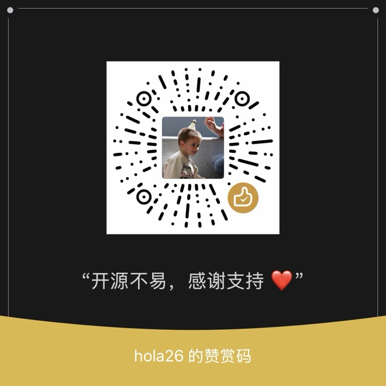

# ☕ Sponsor / 赞助

> PhD student here, surviving on instant noodles and free campus WiFi 🍜 
> Buy me a coffee and maybe I'll upgrade to a noodle with an egg 🥚

> 开源不易，赏口饭吃 🍚 
> 吃泡面的时候我也想加个蛋 😭

[Rayburst](https://github.com/AnInsomniacy/rayburst), [Aria2 Next](https://github.com/AnInsomniacy/aria2-next) and everything else I build stay free. Sponsorships keep the late nights going.

---

## 🌍 International: GitHub Sponsors

👇 Monthly or one-time. Less than a coffee, more than a Star ⭐

---

## 🇨🇳 国内用户：微信 / 支付宝

📱 扫码赞助，金额随意，心意无价 ❤️

| 微信赞赏码 | 支付宝收款码 |
|:---:|:---:|
|  |  |
| 微信扫一扫 | 支付宝扫一扫 |

---

<b>Thank you for keeping the noodles warm · 感谢每一份支持 🙏</b>

